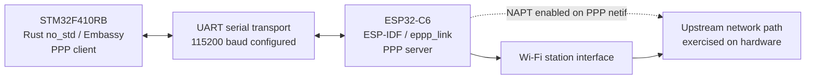
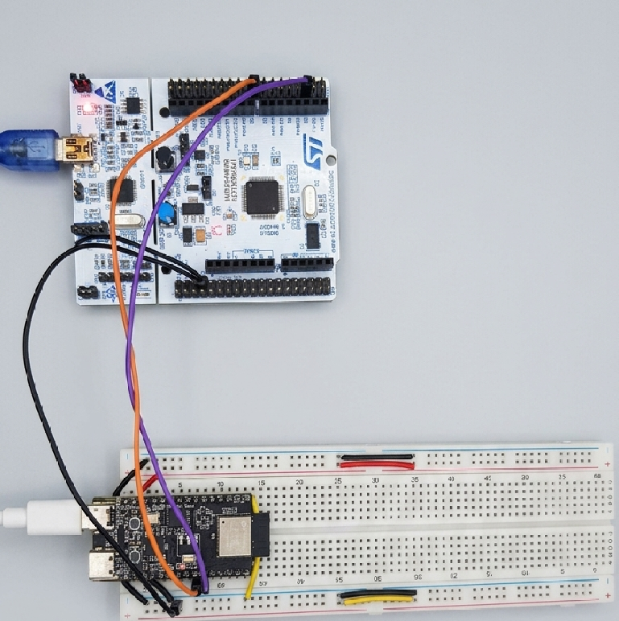

# ESP32-C6 ↔ STM32F410RB UART/PPP Bridge

A two-microcontroller firmware project that connects an ESP32-C6 Wi-Fi station to an STM32F410RB over a UART-based Point-to-Point Protocol (PPP) link.

The ESP32-C6 runs an ESP-IDF application that starts an EPPP PPP server over UART and enables NAPT on the returned PPP network interface. The STM32F410RB runs a `no_std` Rust application built with Embassy. It acts as the PPP client and starts HTTP and MQTT diagnostic tasks after IPv4 network configuration becomes available.

The project demonstrates how a small microcontroller can use a second MCU as a Wi-Fi gateway through a serial PPP link, combining ESP-IDF, Embassy, asynchronous embedded Rust, UART transport, IPv4 networking, DNS, TCP, HTTP, and MQTT.

> **Hardware validation:** Both firmware applications have been successfully built in their respective Docker development environments, flashed to their physical development boards, and exercised together on hardware. The repository does not yet include a formal test report or a complete set of runtime logs, photographs, packet captures, or performance measurements.
## Project status

The table distinguishes implementation in the repository from the hardware validation reported by the project maintainer.

| Area | Implementation in `dev` | Validation status |
|---|---|---|
| ESP32-C6 Wi-Fi station and NVS initialization | Implemented in `ESP32C6_EPPP_LINK_UART/main/main.c` | Exercised during the successful hardware run; runtime logs are not committed |
| EPPP server over UART | Implemented using `eppp_listen()` with UART transport | UART/PPP bridge exercised on physical hardware; detailed negotiation logs are not committed |
| NAPT | `esp_netif_napt_enable()` is called for the PPP network interface returned by `eppp_listen()` | Included in the hardware-tested gateway run; no separate forwarding test report is committed |
| STM32F410RB Embassy network runner and PPP client | Implemented in `stm32-f410-ppp-client/src/main.rs` | Exercised on physical hardware as part of the integrated project run |
| IPv4 and DNS configuration | PPP status callback applies the reported local address and DNS servers, with a fallback DNS address | Exercised as part of the integrated hardware run; no captured configuration report is committed |
| HTTP diagnostic | DNS lookup, TCP connection to port 80, HTTP/1.0 request, and response-byte-count logging | Diagnostic firmware was included in the hardware run; detailed response logs are not committed |
| MQTT diagnostic | Plaintext MQTT connection to `broker.hivemq.com:1883` and QoS 1 publish flow | Diagnostic firmware was included in the hardware run; no broker-side capture or MQTT log transcript is committed |
| ESP32-C6 build and flash | ESP-IDF project and pinned development-container image | Successfully built and flashed, maintainer-confirmed |
| STM32F410RB build and flash | Cargo project and STM32 development container | Successfully built and flashed, maintainer-confirmed |
| MQTT subscription and application-level reply handling | Not present in the checked-in STM32 smoke-test code | Not implemented |
| Performance and endurance measurements | No measurement report or benchmark harness is included | Not documented; do not infer from successful functional testing |

## System architecture

The following diagram represents the source-defined architecture. The integrated firmware has also been exercised on physical hardware, as noted above.



The ESP32-C6 connects to a Wi-Fi network as a station. It then configures `eppp_link` to listen for a PPP connection over UART. The STM32F410RB configures the corresponding PPP client over USART1. On the ESP32, the application calls `esp_netif_napt_enable()` with the PPP network interface returned by `eppp_listen()`.

The diagram describes the configured topology and the tested system arrangement; it does not represent a measured throughput result or a formal routing test report.

## Repository layout

```text
.
├── README.md
├── LICENSE.txt
├── .vscode/
├── ESP32C6_EPPP_LINK_UART/
│   ├── CMakeLists.txt
│   ├── dependencies.lock
│   ├── main/
│   │   ├── CMakeLists.txt
│   │   ├── idf_component.yml
│   │   └── main.c
│   └── .devcontainer/
├── Images/
│   └── hardware_setup_PPP_image.png
└── stm32-f410-ppp-client/
    ├── Cargo.toml
    ├── Cargo.lock
    ├── build.rs
    ├── memory.x
    ├── .cargo/config.toml
    ├── src/main.rs
    ├── Dockerfile
    └── .devcontainer/
```

## Hardware and serial configuration

The two firmware targets are ESP32-C6 and STM32F410RB. Both sides configure the UART link for 115200 baud. The firmware has been exercised using the physical UART interconnection.

| Setting | Configured value | Source |
|---|---|---|
| ESP32-C6 UART TX | GPIO 21 | [`main.c`](ESP32C6_EPPP_LINK_UART/main/main.c) |
| ESP32-C6 UART RX | GPIO 20 | [`main.c`](ESP32C6_EPPP_LINK_UART/main/main.c) |
| UART baud rate | 115200 | ESP32 and STM32 firmware entry points |
| STM32 UART peripheral | USART1 | [`main.rs`](stm32-f410-ppp-client/src/main.rs) |
| STM32 USART1 RX | PA10 | [`main.rs`](stm32-f410-ppp-client/src/main.rs) |
| STM32 USART1 TX | PA9 | [`main.rs`](stm32-f410-ppp-client/src/main.rs) |
| STM32 UART TX buffer | 512 bytes, statically allocated | [`main.rs`](stm32-f410-ppp-client/src/main.rs) |
| STM32 UART RX buffer | 512 bytes, statically allocated | [`main.rs`](stm32-f410-ppp-client/src/main.rs) |

The source assigns the STM32 USART1 peripheral pins but does not document the physical wire-to-wire mapping, board connector locations, voltage levels, or flow-control wiring. Consult the board documentation when reproducing the physical connection.

The ESP32 Wi-Fi SSID and password are currently placeholders (`YOUR_WIFI_SSID` and `YOUR_WIFI_PASSWORD`) in the checked-in source. Replace them with local credentials before building for a network test, and do not commit personal Wi-Fi credentials.
### Hardware Setup

**Development Boards**

- [STMicroelectronics NUCLEO-F410RB](https://www.st.com/en/evaluation-tools/nucleo-f410rb.html)
- [Espressif ESP32-C6-DevKitM-1](https://docs.espressif.com/projects/esp-dev-kits/en/latest/esp32c6/esp32-c6-devkitm-1/user_guide.html)



## Firmware architecture

### ESP32-C6 gateway — ESP-IDF

[`ESP32C6_EPPP_LINK_UART/main/main.c`](ESP32C6_EPPP_LINK_UART/main/main.c) contains `app_main()` and `wifi_init()`.

The application performs the following operations:

1. Initializes NVS. If initialization returns `ESP_ERR_NVS_NO_FREE_PAGES` or `ESP_ERR_NVS_NEW_VERSION_FOUND`, it erases NVS and initializes it again.
2. Initializes the ESP network interface and default event loop, then creates the default Wi-Fi station interface.
3. Initializes Wi-Fi in station mode and applies the SSID/password constants from the source.
4. Calls `esp_wifi_connect()` when the station starts and retries the connection after a station-disconnected event. It waits for `IP_EVENT_STA_GOT_IP` before continuing.
5. Creates `EPPP_DEFAULT_SERVER_CONFIG()`, selects `EPPP_TRANSPORT_UART`, and configures TX GPIO 21, RX GPIO 20, and 115200 baud.
6. Calls `eppp_listen()` to start the PPP server. If the call returns a null network interface, it logs an error and returns.
7. Calls `esp_netif_napt_enable()` for the returned PPP network interface and logs the PPP/NAPT status.

The firmware contains log statements for Wi-Fi and PPP/NAPT milestones. Runtime logs from the hardware run are not currently included in the repository.

### STM32F410RB client — Rust `no_std` / Embassy

[`stm32-f410-ppp-client/src/main.rs`](stm32-f410-ppp-client/src/main.rs) initializes the Embassy STM32 HAL, a buffered USART1 interface, the PPP device, and the Embassy network stack.

The executor starts the following tasks:

| Task | Responsibility |
|---|---|
| `network_runner_task` | Runs the Embassy network stack runner. |
| `ppp_runner_task` | Runs the PPP client over buffered USART1 and applies IPv4/DNS configuration from PPP status. If the PPP runner terminates with an error, it logs the error and waits in a five-second loop; it does not automatically restart the PPP runner. |
| `http_smoke_test` | Repeatedly resolves `example.com`, opens TCP port 80, sends an HTTP/1.0 GET request, reads up to 96 response bytes, and logs the returned byte count. |
| `mqtt_smoke_test` | Repeatedly resolves the MQTT broker, opens TCP port 1883, connects using `minimq`, publishes one QoS 1 test message, polls for completion, and disconnects. |

`main()` initializes the network stack, spawns the network and PPP runner tasks, waits for `stack.wait_config_up()`, and then starts the HTTP and MQTT diagnostic tasks.

The network stack is initialized with `StackResources<3>`. The source also uses a fixed `NETWORK_SEED` value for this connectivity example. The source comment explicitly says this deterministic seed is not a cryptographic entropy source and must not be reused for TLS keys or nonces.

### PPP IPv4 and DNS configuration

The STM32 PPP status callback performs the following steps:

- Returns without applying a new configuration if the PPP status contains no local IPv4 address.
- Converts the negotiated local address into `Ipv4Cidr::new(local_address, 0)`, using prefix length `0` in the configured address.
- Copies the DNS servers reported by PPP into a fixed-capacity `heapless::Vec` with capacity 3.
- Adds `1.1.1.1` if no DNS server was reported.
- Applies `ConfigV4::Static` with `gateway: None`.

These are the exact configuration values used by the checked-in source. The repository does not explain the design rationale for prefix length `0` or the absence of an explicit gateway. Successful hardware operation should not be interpreted as a substitute for documenting the address and routing design; this is a useful area for a future design note.

## Network and application diagnostics

### HTTP diagnostic

The STM32 task performs an A-record DNS query for `example.com`, selects the first returned IPv4 address, and attempts a TCP connection to port 80. It sends the following clear-text HTTP/1.0 request:

```http
GET / HTTP/1.0
Host: example.com
Connection: close


```

The task writes the request, flushes the socket, performs one read into a 96-byte response buffer, and logs the number of response bytes returned. It does not parse or validate the HTTP status code or response body. The hardware run exercised the firmware diagnostic path; response transcripts are not committed in this repository.

### MQTT diagnostic

The STM32 task implements a **plaintext MQTT QoS 1 publish smoke test over TCP port 1883**.

| Item | Value in source |
|---|---|
| MQTT crate | `minimq` 0.13.5 |
| Broker hostname | `broker.hivemq.com` |
| Broker port | `1883` |
| Client ID | `stm32-f410-ppp-absdskajbdsh` |
| Topic | `stm32-f410-ppp/test` |
| Payload | `hello from STM32 over PPP` |
| Publish QoS | QoS 1 (`AtLeastOnce`) |

The task resolves the broker hostname, opens a TCP connection, calls `Session::connect()`, publishes the test payload, and polls the operation while it is pending. When the operation completes, the source logs that the QoS 1 publication was acknowledged by the broker. It then disconnects and repeats the test loop.

The checked-in client does not configure MQTT username/password authentication or TLS. It does not subscribe to a topic or process application-level reply messages. The public broker, fixed client ID, and shared topic are for connectivity testing only; do not use this configuration for sensitive data or production deployments. The repository does not include a broker-side capture or a committed runtime log transcript.

## Software and development environments

The following versions and settings are taken from the checked-in manifests, lockfiles, Dockerfiles, and configuration files. Where applicable, the table distinguishes the manifest requirement from the lockfile-resolved version.

| Component | Version or configuration | Repository evidence |
|---|---|---|
| ESP-IDF | 5.4.4 resolved in the ESP component lockfile | `ESP32C6_EPPP_LINK_UART/dependencies.lock` |
| ESP-IDF container | `espressif/idf:release-v5.4`, pinned by image digest | `ESP32C6_EPPP_LINK_UART/.devcontainer/Dockerfile` |
| ESP target | `esp32c6` | `ESP32C6_EPPP_LINK_UART/dependencies.lock` |
| `espressif/eppp_link` | 1.1.6 locked; manifest requirement `^1.1.6` | ESP component manifest and lockfile |
| `espressif/esp_serial_slave_link` | 1.1.2 locked as a dependency of `eppp_link` | `ESP32C6_EPPP_LINK_UART/dependencies.lock` |
| Rust edition | 2021 | `stm32-f410-ppp-client/Cargo.toml` |
| Rust target | `thumbv7em-none-eabihf` | `stm32-f410-ppp-client/.cargo/config.toml` |
| `embassy-executor` | 0.9.1 | `Cargo.toml` / `Cargo.lock` |
| `embassy-time` | 0.5.0 requirement; 0.5.1 locked | `Cargo.toml` / `Cargo.lock` |
| `embassy-stm32` | 0.5.0 | `Cargo.toml` / `Cargo.lock` |
| `embassy-net` | 0.9.1 | `Cargo.toml` / `Cargo.lock` |
| `embassy-net-ppp` | 0.3.0 | `Cargo.toml` / `Cargo.lock` |
| `minimq` | 0.13.5 | `Cargo.toml` / `Cargo.lock` |
| STM32 container base | `mcr.microsoft.com/devcontainers/base:ubuntu` (no image tag or digest pin in the Dockerfile) | `stm32-f410-ppp-client/Dockerfile` |

The ESP32 container uses the Espressif IDF image pinned by digest `sha256:151694440c974ab29fad02137dc0fbb4b6c4f9a2586d7c7f1e8ec8288386186d`. The ESP-IDF component lockfile resolves ESP-IDF 5.4.4, `eppp_link` 1.1.6, and `esp_serial_slave_link` 1.1.2.

The STM32 Dockerfile installs a minimal Rust toolchain, `rustfmt`, `clippy`, the `thumbv7em-none-eabihf` target, `flip-link`, and `probe-rs-tools`. It does not pin an exact Rust compiler version or exact versions of the installed tools.

The STM32 Cargo configuration:

- Sets `thumbv7em-none-eabihf` as the default build target.
- Uses `flip-link` as the linker.
- Passes `link.x`, `defmt.x`, and `--nmagic` linker arguments.
- Sets `DEFMT_LOG=info`.
- Configures `probe-rs run --chip STM32F410RB --speed 100` as the target runner.

The [`memory.x`](stm32-f410-ppp-client/memory.x) linker script declares 128 KiB FLASH at `0x08000000` and 32 KiB RAM at `0x20000000`. These are linker configuration values.

## Build and flash

Both applications have been successfully built and flashed using their respective Docker development environments. The following commands show the project build/flash workflow. Replace `<PORT>` with the serial port used by the ESP32-C6.

### ESP32-C6 — ESP-IDF

Open the ESP32 development container, then run from the ESP-IDF project directory:

```sh
cd ESP32C6_EPPP_LINK_UART
idf.py set-target esp32c6
idf.py build
idf.py -p <PORT> flash monitor
```

The ESP32 project root is `ESP32C6_EPPP_LINK_UART/`. Its CMake configuration uses `IDF_PATH`, and the devcontainer Dockerfile sources the ESP-IDF environment from `/opt/esp/idf/export.sh` through the container shell configuration.

Before building for your own Wi-Fi network, replace the local SSID and password placeholders in `main/main.c`. Keep real credentials out of version control.

### STM32F410RB — Embassy Rust

Open the STM32 development container and run from the Cargo project directory:

```sh
cd stm32-f410-ppp-client
cargo rrb stm32-f410-ppp-client # cargo rrb utilizes flip-link
```

The `.cargo/config.toml` selects the `thumbv7em-none-eabihf` target and configures `probe-rs run --chip STM32F410RB --speed 100` as the runner. Consequently, `cargo rrb stm32-f410-ppp-client` builds and invokes the configured runner to program and run the firmware on a connected STM32F410RB through a supported probe.

The configured runner and flashing workflow have been used for the successful hardware run. Ensure the debug probe is connected and accessible inside the development container.

Ensure the harware is connected before building and opening the contianer.

**Output Example:**

```sh
     Erasing ✔ 100% [####################] 128.00 KiB @  32.09 KiB/s (took 4s)                                                                                            Programming ✔ 100% [####################]  86.00 KiB @   3.05 KiB/s (took 28s)                                                                                              Finished in 32.33s
[INFO ] STM32F410RB PPP client starting (stm32_f410_ppp_client stm32-f410-ppp-client/src/main.rs:269)
[INFO ] IPv4: DOWN (embassy_net embassy-net-0.9.1/src/lib.rs:788)
[INFO ] PPP client started; waiting for IPv4 configuration (stm32_f410_ppp_client stm32-f410-ppp-client/src/main.rs:281)
[INFO ] PPP link phase Establish -> Network (ppproto src/ppp/mod.rs:158)
[INFO ] PPP link phase Network -> Open (ppproto src/ppp/mod.rs:158)
[INFO ] PPP IPv4 configured (stm32_f410_ppp_client stm32-f410-ppp-client/src/main.rs:78)
[INFO ] link_up = true (embassy_net embassy-net-0.9.1/src/lib.rs:889)
[INFO ] PPP IP configuration is up (stm32_f410_ppp_client stm32-f410-ppp-client/src/main.rs:305)
[INFO ] Resolving MQTT broker (stm32_f410_ppp_client stm32-f410-ppp-client/src/main.rs:178)
[INFO ] Resolving example.com (stm32_f410_ppp_client stm32-f410-ppp-client/src/main.rs:96)
[INFO ] Connecting to MQTT broker (stm32_f410_ppp_client stm32-f410-ppp-client/src/main.rs:201)
[INFO ] DNS resolved; opening TCP port 80 (stm32_f410_ppp_client stm32-f410-ppp-client/src/main.rs:114)
[INFO ] TCP connected; sending clear-text HTTP diagnostic request (stm32_f410_ppp_client stm32-f410-ppp-client/src/main.rs:130)
[INFO ] HTTP diagnostic response bytes: 96 (stm32_f410_ppp_client stm32-f410-ppp-client/src/main.rs:147)
[INFO ] HTTP smoke test complete; repeating in 30 seconds (stm32_f410_ppp_client stm32-f410-ppp-client/src/main.rs:152)
[INFO ] Connected with a fresh broker session (minimq mqtt_client/session/handshake.rs:230)
[INFO ] Connected to MQTT broker; publishing test message (stm32_f410_ppp_client stm32-f410-ppp-client/src/main.rs:224)
[INFO ] MQTT QoS 1 publish acknowledged by broker (stm32_f410_ppp_client stm32-f410-ppp-client/src/main.rs:255)
[INFO ] Graceful disconnect requested (minimq mqtt_client/session/operations.rs:25)
[INFO ] MQTT smoke test complete; repeating in 30 seconds (stm32_f410_ppp_client stm32-f410-ppp-client/src/main.rs:262)
[INFO ] Resolving example.com (stm32_f410_ppp_client stm32-f410-ppp-client/src/main.rs:96)
[INFO ] DNS resolved; opening TCP port 80 (stm32_f410_ppp_client stm32-f410-ppp-client/src/main.rs:114)
[INFO ] TCP connected; sending clear-text HTTP diagnostic request (stm32_f410_ppp_client stm32-f410-ppp-client/src/main.rs:130)
[INFO ] HTTP diagnostic response bytes: 96 (stm32_f410_ppp_client stm32-f410-ppp-client/src/main.rs:147)
[INFO ] HTTP smoke test complete; repeating in 30 seconds (stm32_f410_ppp_client stm32-f410-ppp-client/src/main.rs:152)
```

## Hardware validation and test status

Both firmware applications were built, flashed, and successfully exercised together on physical hardware. The status below records that validation while separately identifying the test artifacts that are not yet published in the repository.

| Test area | Result | Evidence available in repository |
|---|---|---|
| ESP32-C6 firmware build | Passed — maintainer-confirmed | Build output not committed |
| STM32F410RB firmware build | Passed — maintainer-confirmed | Build output not committed |
| ESP32-C6 firmware flashing | Passed — maintainer-confirmed | Flash log not committed |
| STM32F410RB firmware flashing | Passed — maintainer-confirmed | Flash log not committed |
| Physical UART interconnection | Exercised during the successful hardware run | Wiring diagram and serial capture not committed |
| ESP32 Wi-Fi station and PPP gateway startup | Exercised during the successful hardware run | Runtime log not committed |
| UART PPP client/server link | Exercised during the successful hardware run | PPP negotiation log not committed |
| STM32 IPv4/DNS setup | Exercised as part of the integrated firmware run | Captured interface/DNS configuration not committed |
| HTTP diagnostic task | Included and exercised in the hardware run | HTTP response transcript not committed |
| MQTT QoS 1 publish diagnostic | Included and exercised in the hardware run | MQTT runtime log or broker-side capture not committed |
| NAPT/upstream connectivity | Part of the tested gateway configuration | Separate routing/forwarding report not committed |

“Maintainer-confirmed” indicates that the project owner reports completing the test on physical hardware. It does not imply that the raw test logs or a formal test procedure are included in this repository. The absence of a committed log is a documentation gap, not evidence that the test was never performed.

## Limitations and known gaps

- The repository does not yet include a formal hardware validation report, complete runtime logs, packet captures, or a repeatable test procedure.
- A dedicated wiring diagram, schematic, board photographs, physical connector mapping, and detailed electrical-interface notes are not included.
- The source configures IPv4 using the negotiated local address with prefix length `0` and `gateway: None`. The repository does not document the design rationale for these values.
- The STM32 PPP runner error path logs the failure and waits; it does not automatically restart the PPP runner.
- The HTTP diagnostic reads up to 96 response bytes but does not parse or validate the HTTP status or body.
- MQTT uses plaintext TCP port 1883. The checked-in client does not configure TLS or MQTT username/password authentication.
- MQTT publish is implemented; subscription and application-level reply handling are not.
- The MQTT client ID and topic are hardcoded test values intended for a public-broker smoke test, not production use.
- The `NETWORK_SEED` constant is deterministic and is explicitly not a cryptographic entropy source.
- No throughput, latency, power-consumption, memory-utilization, or long-duration stability measurements are included.
- No dedicated network interruption, PPP renegotiation, or recovery test report is included.
- The exact Rust compiler version and installed versions of `flip-link` and `probe-rs-tools` are not pinned in the STM32 container configuration.
- Wi-Fi SSID and password are placeholders in the checked-in ESP32 source and must be configured locally.

## Possible next steps

These are potential extensions and documentation improvements, not claims about current functionality:

- Publish representative ESP32, UART/PPP, STM32, HTTP, and MQTT runtime logs from a successful test run.
- Add a reproducible validation procedure covering Wi-Fi association, PPP negotiation, IPv4/DNS configuration, and upstream connectivity.
- Document the IPv4 prefix and gateway configuration rationale.
- Add controlled network interruption, PPP recovery, and long-duration stability tests.
- Measure throughput, latency, memory use, and power consumption with a documented setup.
- Add MQTT TLS and broker authentication before using MQTT for anything beyond a public plaintext diagnostic.
- Add MQTT subscription and application-level response handling if bidirectional messaging is required.
- Pin the Rust toolchain and relevant container-installed tool versions for tighter environment reproducibility.
- Add automated build checks for both firmware applications.
- Connection recoveries and retries.

## Source files

### ESP32-C6

- [Application entry point](ESP32C6_EPPP_LINK_UART/main/main.c)
- [Project CMake configuration](ESP32C6_EPPP_LINK_UART/CMakeLists.txt)
- [Component CMake configuration](ESP32C6_EPPP_LINK_UART/main/CMakeLists.txt)
- [Component manifest](ESP32C6_EPPP_LINK_UART/main/idf_component.yml)
- [Resolved component dependencies](ESP32C6_EPPP_LINK_UART/dependencies.lock)
- [Development-container Dockerfile](ESP32C6_EPPP_LINK_UART/.devcontainer/Dockerfile)
- [Devcontainer configuration](ESP32C6_EPPP_LINK_UART/.devcontainer/devcontainer.json)

### STM32F410RB

- [Application entry point](stm32-f410-ppp-client/src/main.rs)
- [Cargo manifest](stm32-f410-ppp-client/Cargo.toml)
- [Locked Rust dependencies](stm32-f410-ppp-client/Cargo.lock)
- [Cargo target, linker, and runner configuration](stm32-f410-ppp-client/.cargo/config.toml)
- [Linker memory regions](stm32-f410-ppp-client/memory.x)
- [Build script](stm32-f410-ppp-client/build.rs)
- [Development-container Dockerfile](stm32-f410-ppp-client/Dockerfile)
- [Devcontainer configuration](stm32-f410-ppp-client/.devcontainer/devcontainer.json)

## License

This project is distributed under the [MIT License](LICENSE.txt).
