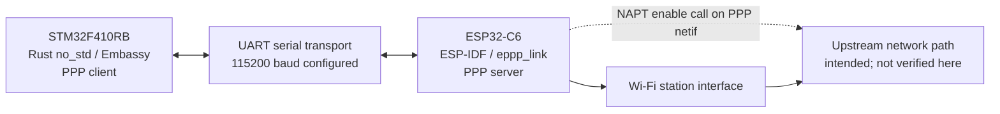

# ESP32-C6 ↔ STM32F410RB UART/PPP Bridge

A two-MCU firmware project exploring a serial PPP link between an ESP32-C6 Wi-Fi station and an STM32F410RB. The ESP32 application is written for ESP-IDF and configures an EPPP PPP server over UART; the STM32 application is `no_std` Rust using Embassy and configures a PPP client, with HTTP and MQTT diagnostic tasks in source.

> **Evidence boundary:** The `dev` branch contains ESP-IDF and Embassy firmware configured for an ESP32-C6-to-STM32F410RB UART/PPP bridge, with HTTP and MQTT smoke-test code. Hardware test results are not recorded in this branch. Source code and configuration demonstrate implementation intent, not successful builds, flashed boards, physical wiring, or end-to-end operation.

## Status at a glance

| Area | Evidence in `dev` | Status |
|---|---|---|
| ESP32 Wi-Fi station and NVS setup | Implemented in `ESP32C6_EPPP_LINK_UART/main/main.c` | Implemented in source; operation not verified in this branch |
| EPPP server over UART, with NAPT enable call | Implemented in the same ESP-IDF source | Implemented in source; hardware/network behavior not verified |
| STM32 Embassy network runner and PPP client | Implemented in `stm32-f410-ppp-client/src/main.rs` | Implemented in source; operation not verified in this branch |
| IPv4/DNS configuration callback | Implemented in STM32 source | Configured in source; routing behavior not independently validated |
| HTTP diagnostic | DNS lookup, TCP port 80 request, and response-byte-count logging are in source | Code present; success not evidenced in branch |
| MQTT diagnostic | `minimq` session and QoS 1 publish to `broker.hivemq.com:1883` are in source | Plaintext publish smoke-test code present; connection/delivery not evidenced in branch |
| Build | Project manifests and container definitions are present | No build result is recorded in this branch; this README task did not execute builds |
| Hardware validation | No committed wiring diagram, board photos, or test report found | Not documented in this branch |
| MQTT subscription/reply | No subscription or application-level response handling in the STM32 source | Not implemented in the checked-in smoke-test code |

## Source-derived system architecture

The diagram describes configured code paths only. It is not evidence that the hardware link, Wi-Fi, PPP, NAPT, or external connectivity has been tested.



The ESP32 source calls `eppp_listen()` with the UART transport and then calls `esp_netif_napt_enable()` for the returned PPP network interface. This documents the configured call sequence; it does not establish that forwarding works in a running system.

## Repository layout

```text
.
├── README.md
├── LICENSE.txt
├── .vscode/
├── ESP32C6_EPPP_LINK_UART/
│   ├── CMakeLists.txt
│   ├── dependencies.lock
│   ├── main/
│   │   ├── CMakeLists.txt
│   │   ├── idf_component.yml
│   │   └── main.c
│   └── .devcontainer/
└── stm32-f410-ppp-client/
    ├── Cargo.toml
    ├── Cargo.lock
    ├── build.rs
    ├── memory.x
    ├── .cargo/config.toml
    ├── src/main.rs
    ├── Dockerfile
    └── .devcontainer/
```

## Hardware and serial configuration

The source/configuration identifies the MCU targets as ESP32-C6 and STM32F410RB. The repository does not include physical board wiring instructions, a schematic, or hardware photographs.

| Setting | Configured value | Source |
|---|---|---|
| ESP32 UART TX GPIO | 21 | `ESP32C6_EPPP_LINK_UART/main/main.c` |
| ESP32 UART RX GPIO | 20 | `ESP32C6_EPPP_LINK_UART/main/main.c` |
| UART baud rate | 115200 | Both firmware entry points |
| STM32 UART peripheral | USART1 | `stm32-f410-ppp-client/src/main.rs` |
| STM32 UART pins passed to `BufferedUart::new` | PA10, PA9 | `stm32-f410-ppp-client/src/main.rs` |
| STM32 UART buffers | 512-byte TX and RX static buffers | `stm32-f410-ppp-client/src/main.rs` |

The source gives the STM32 USART pin arguments but does not state the physical wire-to-wire mapping, board connector locations, voltage levels, or flow-control wiring. Confirm those against the specific boards and their hardware documentation before connecting them.

The ESP32 Wi-Fi SSID and password are literal placeholders (`YOUR_WIFI_SSID` and `YOUR_WIFI_PASSWORD`) in the checked-in C source. Replace them locally for a test and do not commit real credentials.

## Firmware architecture

### ESP32-C6 gateway — ESP-IDF

`ESP32C6_EPPP_LINK_UART/main/main.c` implements `app_main()` and `wifi_init()`:

1. Initializes NVS; erases and reinitializes it for the two handled NVS error cases.
2. Initializes the default event loop and Wi-Fi station interface.
3. Configures Wi-Fi station credentials from source constants and starts Wi-Fi. The event handler retries `esp_wifi_connect()` on station disconnect and signals the wait when `IP_EVENT_STA_GOT_IP` arrives.
4. Creates `EPPP_DEFAULT_SERVER_CONFIG()`, selects UART transport, assigns GPIO 21/20 and 115200 baud, and calls `eppp_listen()`.
5. Checks for a null PPP network interface and, when non-null, calls `esp_netif_napt_enable()` on it.

The code logs messages for Wi-Fi and PPP/NAPT milestones, but no runtime log capture is committed on this branch.

### STM32F410RB client — Rust `no_std` / Embassy

`stm32-f410-ppp-client/src/main.rs` configures the Embassy STM32 HAL, USART1 buffered UART, PPP device, and Embassy network stack. The PPP callback reads the reported local address and DNS server list, then applies IPv4 configuration to the stack.

The executor starts these tasks:

| Task | Responsibility in source |
|---|---|
| `network_runner_task` | Runs the Embassy network stack runner. |
| `ppp_runner_task` | Runs the PPP client over the buffered UART, then applies IPv4/DNS configuration from PPP status. On runner error, logs an error and waits in a loop. |
| `http_smoke_test` | Repeatedly resolves `example.com`, opens TCP port 80, sends an HTTP/1.0 GET, reads up to 96 response bytes, and logs the byte count. |
| `mqtt_smoke_test` | Repeatedly resolves the broker, opens TCP port 1883, connects with `minimq`, publishes one QoS 1 test message, polls for publish completion, and disconnects. |

`main()` waits for `stack.wait_config_up()` before spawning the HTTP and MQTT tasks. These task bodies and logs are source behavior, not recorded test outcomes.

### PPP IPv4 and DNS details

The STM32 PPP status callback:

- returns without changing configuration if the callback has no local IPv4 address;
- converts the reported local address into `Ipv4Cidr::new(local_address, 0)`, i.e. uses prefix length `0` in the configured address;
- copies reported DNS servers into a fixed-capacity `heapless::Vec` (capacity 3);
- adds `1.1.1.1` if that list is empty;
- applies `ConfigV4::Static` with `gateway: None`.

These are the values passed to the Embassy stack by the source. The branch does not document why prefix length `0` or no explicit gateway is selected, nor does it provide independent route/connectivity validation. `StackResources<3>` is the configured socket-storage capacity; no utilization or memory measurement is recorded.

## Network and application diagnostics

### HTTP

The STM32 task resolves `example.com` using an A query, connects to the first returned IPv4 address on TCP port 80, and sends:

```text
GET / HTTP/1.0\r\nHost: example.com\r\nConnection: close\r\n\r\n
```

It reads once into a 96-byte buffer and logs the number of bytes returned. It does not parse or validate the HTTP status or body. The source does not prove that the request succeeds on a live network.

### MQTT

The STM32 task is a **plaintext QoS 1 publish smoke test configured for port 1883**:

| Item | Value in source |
|---|---|
| MQTT crate | `minimq` 0.13.5 (manifest requirement; locked version shown in `Cargo.lock`) |
| Broker hostname | `broker.hivemq.com` |
| Broker port | `1883` |
| Client ID | `stm32-f410-ppp-absdskajbdsh` |
| Topic | `stm32-f410-ppp/test` |
| Payload | `hello from STM32 over PPP` |
| Publish QoS | QoS 1 (`AtLeastOnce`) |

The code resolves the broker hostname, opens TCP, calls `Session::connect`, publishes, and polls while the QoS 1 operation remains pending. It does not configure MQTT username/password, TLS, a subscription, or application-level reply handling. The log text for a publish acknowledgment is code, not evidence that a broker acknowledged a message in a test.

Do not use this plaintext public-broker smoke test for sensitive data or treat the shared topic/client settings as a production configuration.

## Software and development environments

Versions below are taken from the committed manifests, lockfiles, Dockerfiles, and container configuration. A manifest requirement is distinguished from a lockfile-resolved version. No Rust toolchain version is pinned in the inspected project files.

| Component | Repository-defined version/configuration | Evidence |
|---|---|---|
| ESP-IDF | 5.4.4 in component lockfile; Docker image tag `release-v5.4` is pinned by digest `sha256:151694440c974ab29fad02137dc0fbb4b6c4f9a2586d7c7f1e8ec8288386186d` | ESP32 `dependencies.lock`, `.devcontainer/Dockerfile` |
| ESP target | `esp32c6` | ESP32 `dependencies.lock` |
| `espressif/eppp_link` | 1.1.6 locked; manifest range `^1.1.6` | ESP32 `dependencies.lock`, `main/idf_component.yml` |
| `espressif/esp_serial_slave_link` | 1.1.2 locked | ESP32 `dependencies.lock` |
| Rust edition | 2021 | STM32 `Cargo.toml` |
| Rust target | `thumbv7em-none-eabihf` | STM32 `.cargo/config.toml` |
| `embassy-executor` | 0.9.1 | STM32 `Cargo.toml` / `Cargo.lock` |
| `embassy-time` | 0.5.0 manifest requirement; 0.5.1 locked | STM32 `Cargo.toml` / `Cargo.lock` |
| `embassy-stm32` | exactly 0.5.0 | STM32 `Cargo.toml` / `Cargo.lock` |
| `embassy-net` | exactly 0.9.1 | STM32 `Cargo.toml` / `Cargo.lock` |
| `embassy-net-ppp` | exactly 0.3.0 | STM32 `Cargo.toml` / `Cargo.lock` |
| `minimq` | manifest requirement 0.13.5; 0.13.5 locked | STM32 `Cargo.toml` / `Cargo.lock` |
| STM32 container base | `mcr.microsoft.com/devcontainers/base:ubuntu` (no tag/digest pin in Dockerfile) | STM32 `Dockerfile` |

The STM32 `.cargo/config.toml` selects `flip-link`, passes `link.x` and `defmt.x` linker arguments, sets `DEFMT_LOG=info`, and configures `probe-rs run --chip STM32F410RB --speed 100` as the target runner. `memory.x` declares linker regions of 128 KiB FLASH at `0x08000000` and 32 KiB RAM at `0x20000000`; these are configured linker values, not measurements from a device.

The STM32 Dockerfile installs a minimal Rust toolchain, `rustfmt`, `clippy`, the target, `flip-link`, and `probe-rs-tools`. It does not pin a Rust compiler release or versions for the installed tools. The ESP32 container uses the Espressif IDF image above. The ESP32 devcontainer is named `ESP-IDF QEMU` in its JSON configuration; that name alone does not establish that QEMU tests or emulation are implemented.

## Build and flash

No build was executed while preparing this README, and the branch contains no committed build-result report. The repository provides project files and development-container configurations, but does not contain a top-level build script or documented end-to-end setup/flash guide. Treat the commands below as **standard candidate commands inferred from the checked-in ESP-IDF/Cargo configuration, not commands verified by this repository task**.

### ESP32-C6

The ESP-IDF project root is `ESP32C6_EPPP_LINK_UART/`, with `IDF_PATH` expected by its root CMake file and the IDF environment sourced by its container startup configuration.

Candidate commands (not executed here):

```sh
cd ESP32C6_EPPP_LINK_UART
idf.py set-target esp32c6
idf.py build
idf.py -p <PORT> flash monitor
```

`<PORT>` must be replaced with the ESP32 serial device. The repository does not specify a port or document a verified flashing/monitor workflow.

### STM32F410RB

The Cargo project is under `stm32-f410-ppp-client/`. Its Cargo config supplies the target, linker, and `probe-rs` runner.

Candidate commands (not executed here):

```sh
cd stm32-f410-ppp-client
cargo build --locked
cargo run --release --locked
```

The second command is expected to invoke the configured `probe-rs` runner for the STM32F410RB; this behavior has not been tested for this README. The container configuration installs the target and `probe-rs-tools`, but no Rust version is pinned. No separate serial monitor command is configured in the project files.

## Testing and validation status

The source includes diagnostic code, but this branch contains no committed test report, build output, hardware logs, packet captures, or measurement results. Accordingly, all runtime tests below remain unverified based on the branch evidence.

| Test | Expected behavior represented by source/configuration | Evidence in `dev` branch | Status |
|---|---|---|---|
| ESP32 Wi-Fi association | ESP32 station starts, reconnects on disconnect, waits for got-IP event | Wi-Fi setup and event handler in `main.c`; no captured logs | Not verified |
| UART communication | EPPP UART transport configured at 115200 baud with ESP32 GPIO 21 TX / GPIO 20 RX; STM32 USART1 configured at 115200 | Source configuration only; no wiring diagram or serial capture | Not verified |
| PPP negotiation | ESP32 invokes `eppp_listen`; STM32 invokes PPP runner | Source code only; no negotiation log/report | Not verified |
| STM32 IPv4 setup | PPP callback applies address with prefix 0 and no explicit gateway | Source code only; no captured runtime config | Not verified |
| DNS | HTTP and MQTT tasks issue A queries | Calls present in `main.rs`; no captured result | Not verified |
| HTTP diagnostic | TCP connection to port 80, HTTP request, one response read | Code present; no recorded response log | Not verified |
| MQTT connection | MQTT CONNECT over TCP port 1883 | Code present; no recorded broker interaction | Not verified |
| MQTT publication | QoS 1 publish and polling for completion | Code present; no recorded PUBACK evidence | Not verified |
| End-to-end external connectivity | PPP-to-Wi-Fi upstream path used by DNS/TCP tests | NAPT enable call and client tasks in source; no end-to-end report | Not verified |
| Network interruption | Not explicitly tested in committed files | No interruption test/report | Not documented in `dev` branch |
| Recovery/reconnection | Wi-Fi disconnect handler retries Wi-Fi connection; STM32 smoke-test loops retry after selected failures | Source behavior only; PPP/network recovery behavior not demonstrated | Not verified |
| Long-duration stability | No duration test or result included | No stability report | Not documented in `dev` branch |
| Throughput, latency, power, memory use | No measurement harness/report included | No measurements | Not documented in `dev` branch |

## Limitations and known gaps

- No build result or hardware test evidence is recorded in the reviewed branch.
- Physical UART wiring, voltage-level details, schematic, and board photographs are not included.
- PPP negotiation logs and a verified interface/routing report are absent.
- HTTP and MQTT success logs are absent from the repository.
- NAPT is enabled by a source call, but forwarding is not independently validated.
- IPv4 is configured from the PPP address with prefix length `0` and no explicit gateway; the branch does not document the design rationale or validate the resulting routes.
- No throughput, latency, power, memory-utilization, or stability measurements are included.
- No documented failure-injection, interruption, or recovery test results are included.
- MQTT is plaintext on port 1883. No TLS or MQTT credentials are configured in the checked-in client.
- The MQTT task publishes but does not subscribe or process application-level responses.
- ESP32 Wi-Fi credentials are placeholders and must be configured locally before attempting a connection.
- The exact Rust compiler version is not pinned.

## Possible next steps

These are future work, not implemented or validated capabilities:

- Add a wiring diagram, board photos, and explicit UART electrical/interface notes.
- Build both firmware projects in their configured environments and record tool versions and outcomes.
- Validate and capture Wi-Fi association, UART exchange, PPP negotiation, IP/DNS settings, and route behavior.
- Record HTTP and MQTT test logs, including broker acknowledgment evidence.
- Test link loss, reconnection, and sustained operation with repeatable procedures.
- Add MQTT subscription and application-level response handling if bidirectional messaging is required.
- Add TLS and appropriate broker authentication before using MQTT beyond a public plaintext smoke test.
- Measure resource usage and communication performance using documented methods.
- Add automated build checks for both firmware applications.

## Source files

- [ESP32 application entry point](ESP32C6_EPPP_LINK_UART/main/main.c)
- [ESP32 project CMake configuration](ESP32C6_EPPP_LINK_UART/CMakeLists.txt)
- [ESP32 component CMake configuration](ESP32C6_EPPP_LINK_UART/main/CMakeLists.txt)
- [ESP32 component manifest](ESP32C6_EPPP_LINK_UART/main/idf_component.yml)
- [ESP32 locked dependencies](ESP32C6_EPPP_LINK_UART/dependencies.lock)
- [ESP32 devcontainer](ESP32C6_EPPP_LINK_UART/.devcontainer/Dockerfile)
- [STM32 application entry point](stm32-f410-ppp-client/src/main.rs)
- [STM32 Cargo manifest](stm32-f410-ppp-client/Cargo.toml)
- [STM32 locked Rust dependencies](stm32-f410-ppp-client/Cargo.lock)
- [STM32 Cargo target/runner configuration](stm32-f410-ppp-client/.cargo/config.toml)
- [STM32 linker memory regions](stm32-f410-ppp-client/memory.x)
- [STM32 build script](stm32-f410-ppp-client/build.rs)
- [STM32 Dockerfile](stm32-f410-ppp-client/Dockerfile)

## License

This project is distributed under the [MIT License](LICENSE.txt).
